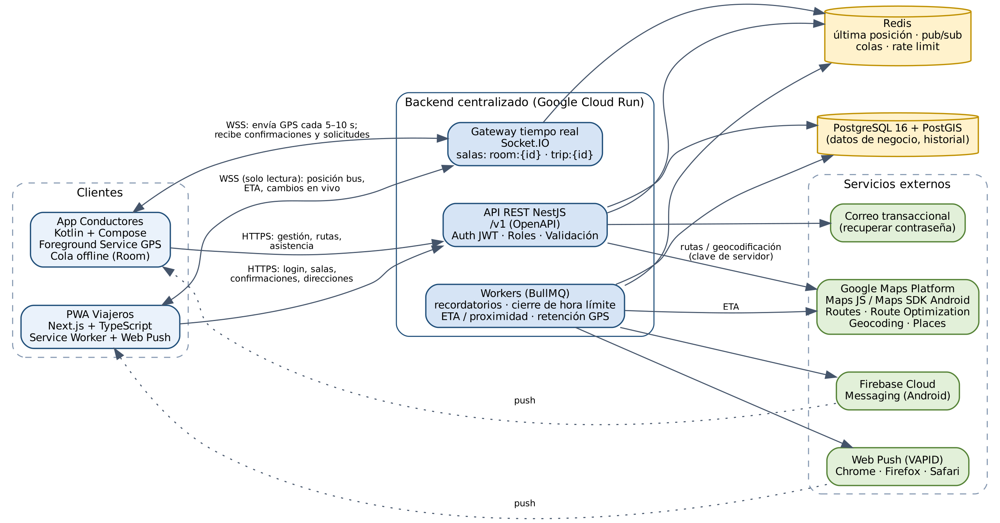

# Plataforma híbrida de transporte privado — Análisis de arquitectura (Fase 1)

**Proyecto:** App para Magdiel · **Versión:** 1.1 · **Fecha:** 19 de noviembre de 2026

Este documento responde a la sección 25 del prompt maestro: define la arquitectura antes de escribir código. Cada decisión está pensada para que el sistema funcione con usuarios reales, crezca a miles de viajeros y no duplique lógica entre la PWA y la app Android.

---

## 1. Arquitectura técnica completa

**Principio rector:** *un solo backend dueño de toda la lógica de negocio*. Los clientes (PWA y Android) son "delgados": muestran datos, capturan acciones y GPS, pero nunca deciden si una confirmación es válida, si se cerró la hora límite, quién puede ver una ubicación o cómo se ordena una ruta. Eso lo decide siempre el servidor.

La plataforma tiene cinco piezas:

| Pieza | Qué hace | Tecnología |
|---|---|---|
| **PWA Viajeros** | Registro, salas por código, direcciones, calendario de confirmaciones, seguimiento del bus, notificaciones, historial | Next.js 15 + React + TypeScript + Tailwind |
| **App Conductores** | Panel, salas, pasajeros, rutas, GPS en segundo plano, asistencia, historial | Kotlin + Jetpack Compose + MVVM + Hilt |
| **API central** | REST versionada `/v1`, autenticación, permisos, reglas de negocio | NestJS (Node.js 22, TypeScript) |
| **Tiempo real** | Difusión de posiciones, ETA, confirmaciones y cambios | Socket.IO sobre WebSocket + adaptador Redis |
| **Workers** | Tareas programadas y pesadas: recordatorios, cierre de hora límite, ETA/proximidad, optimización, retención de GPS | BullMQ (colas en Redis) |

Datos: **PostgreSQL 16 + PostGIS** como fuente de verdad, y **Redis** para lo efímero (última posición, pub/sub, colas, límites de peticiones).

### Flujo clave A — confirmación en tiempo real
1. El viajero marca "Sí viajaré, ida" para mañana en la PWA → `PUT /v1/rooms/{id}/confirmations/{fecha}/{sentido}`.
2. La API valida: que sea miembro activo, que la sala no esté suspendida, que no haya pasado la hora límite (en la zona horaria de la sala) y la capacidad. La restricción única en BD impide duplicados.
3. Se guarda, se escribe el log de cambios y se publica el evento `confirmation.updated` en el canal `room:{id}`.
4. La app del conductor, suscrita a ese canal, actualiza el contador al instante. Si la app está cerrada, recibe push FCM.

### Flujo clave B — recorrido en vivo
1. El conductor inicia el recorrido → la API cambia el estado del `Trip` a `IN_PROGRESS` y habilita el canal `trip:{id}`.
2. El Foreground Service de Android envía la posición cada 5–10 s por WebSocket (con cola local en Room si no hay señal).
3. El servidor guarda la última posición en Redis, persiste puntos en `live_locations` y la retransmite **solo** a sockets autorizados (pasajeros de ese recorrido).
4. Un worker recalcula ETA con Routes API cada ~60 s y dispara avisos de 10 min, 5 min y "en tu parada" sin duplicarlos.
5. Al finalizar: se cierra el canal, se expulsan los sockets, se genera el resumen en `trip_history` y deja de aceptarse GPS para ese recorrido.

### ¿Por qué no Firebase como backend principal?
El prompt permite elegir. Firestore es excelente para prototipos con tiempo real, pero este dominio es **fuertemente relacional** (usuarios ↔ salas ↔ miembros ↔ confirmaciones ↔ recorridos ↔ paradas ↔ asistencia) y necesita:

- **Restricciones únicas y transacciones** reales (evitar confirmaciones duplicadas, validar capacidad sin condiciones de carrera).
- **Consultas geoespaciales** (agrupar paradas cercanas, distancia recorrida) → PostGIS.
- **Reportes e historial con filtros** (fecha, sala, recorrido) → SQL con índices.
- **Permisos complejos** (un viajero en varias salas, la ubicación solo durante recorridos activos) → más claros y testeables en código de servidor que en reglas de Firestore.

Sí usamos **Firebase Cloud Messaging** para push en Android, que es la mejor opción ahí.

---

## 2. Tecnologías seleccionadas

| Capa | Selección |
|---|---|
| Monorepo | pnpm workspaces + Turborepo (TypeScript); proyecto Gradle separado para Android |
| Contrato compartido | OpenAPI 3.1 generado desde NestJS → cliente TS para la PWA y cliente Kotlin (openapi-generator) para Android |
| Backend | NestJS 11, Drizzle ORM (TypeScript puro, migraciones SQL con PostGIS), Zod/class-validator, Socket.IO, BullMQ, Pino (logs) |
| Base de datos | PostgreSQL 16 + PostGIS 3.4, Redis 7 |
| Autenticación | Propia: Argon2id para contraseñas, JWT de acceso (15 min) + refresh token rotativo (30 días) guardado como hash |
| PWA | Next.js 15 (App Router), React 19, TypeScript, Tailwind CSS 4, componentes propios accesibles (Radix primitives), TanStack Query, Serwist (service worker), `@vis.gl/react-google-maps` |
| Android | Kotlin 2.x, Jetpack Compose + Material 3, MVVM, Hilt, Coroutines + StateFlow, Retrofit/OkHttp + kotlinx.serialization, Room, DataStore + Tink (tokens cifrados), Maps Compose, Fused Location Provider, WorkManager, FCM |
| Mapas y rutas | Maps JavaScript API, Maps SDK for Android, Places API (autocompletado), Geocoding API, Routes API (ETA, polilíneas, tráfico), Route Optimization API |
| Push | FCM (Android) y Web Push estándar con VAPID (PWA) |
| Correo | Resend o SendGrid (recuperación de contraseña) |
| Infraestructura | Google Cloud Run (API + workers), Cloud SQL o Neon (Postgres con PostGIS), Upstash/Memorystore (Redis), Vercel o Cloud Run (PWA), Cloud Storage (fotos) |
| CI/CD | GitHub Actions: lint, pruebas, build, despliegue; build firmado de APK/AAB |

---

## 3. Justificación de cada tecnología

- **Drizzle ORM** *(cambio respecto a la v1.0 de este documento, que proponía Prisma)*: es TypeScript puro, sin binarios que descargar, más liviano en Cloud Run y con control total del SQL para PostGIS, triggers y particiones.
- **NestJS:** estructura modular (auth, rooms, confirmations, trips…), inyección de dependencias, guards para permisos y generación de OpenAPI. Mismo lenguaje que la PWA → menos fricción.
- **PostgreSQL + PostGIS:** integridad referencial, transacciones y tipos geográficos (`geography(Point)`), índices GiST para consultas por cercanía. Escala sin problema a millones de filas con particionado.
- **Redis:** la posición en vivo cambia cada pocos segundos; guardarla solo en Postgres sería costoso. Redis sirve la última posición en microsegundos, distribuye eventos entre varias instancias de la API (adaptador Socket.IO) y respalda las colas.
- **Socket.IO:** reconexión automática, salas (`trip:{id}`) y respaldo por long-polling en redes inestables, frecuentes en datos móviles.
- **BullMQ:** tareas con horario exacto (recordatorio 1 h antes de la hora límite, cierre a las 8:00 p. m. en la zona de la sala) con reintentos y sin duplicados.
- **Auth propia con Argon2id + JWT:** sirve igual en web y Android, sin depender de un proveedor; refresh rotativo con detección de reutilización. *(Alternativa válida: Firebase Auth si se prefiere delegar; la arquitectura lo admite cambiando un módulo.)*
- **OpenAPI como contrato:** los modelos de ambos clientes se generan del servidor, así que nunca se desincronizan y no se reescribe lógica.
- **Next.js + Serwist:** PWA instalable, manifest, caché offline del shell, Web Push; SSR para carga rápida en gamas bajas.
- **Tailwind + componentes propios:** identidad visual compartida con Android mediante *design tokens* (colores, radios, tipografía) definidos una sola vez.
- **Kotlin + Compose + Hilt + MVVM:** estándar moderno de Android, recomendado por Google; StateFlow para UI reactiva.
- **Foreground Service (tipo `location`):** única forma fiable y aceptada por Google Play de mantener GPS con la pantalla apagada durante un recorrido.
- **Room:** cola local de puntos GPS y acciones de asistencia cuando no hay conexión; se sincronizan al recuperarla.
- **Route Optimization API:** resuelve el problema real (VRP con capacidad, ventanas horarias, recogida/entrega y varios vehículos), no un simple orden por distancia. Respaldo propio (inserción + 2-opt sobre matriz de Routes API) si la API falla o se agota la cuota, marcado como "ruta aproximada".
- **Cloud Run:** escala automáticamente, cobra por uso y soporta WebSockets.

---

## 4. Diagrama de comunicación



**Canales de tiempo real y quién puede unirse** (validado en el servidor al conectar y en cada evento):

| Canal | Eventos | Quién puede suscribirse |
|---|---|---|
| `user:{id}` | notificaciones internas, cambios de membresía | el propio usuario |
| `room:{id}:driver` | solicitudes nuevas, confirmaciones, exceso de capacidad | el conductor dueño de la sala |
| `room:{id}` | cambios de horario, suspensión de sala | miembros activos |
| `trip:{id}` | posición, ETA, estado de paradas, inicio/fin | pasajeros de ese recorrido, **solo mientras está `IN_PROGRESS`** |

---

## 5. Diseño de base de datos

Convenciones: claves primarias `UUID v7` (ordenables por tiempo), `created_at`/`updated_at` en todas las tablas, borrado lógico (`deleted_at`) donde haga falta historial, enums de Postgres para estados.

### 5.1 Identidad y perfiles

| Tabla | Campos principales | Restricciones / índices |
|---|---|---|
| **users** | id, email, password_hash, role (`TRAVELER`/`DRIVER`), email_verified_at, status, last_login_at | `UNIQUE(lower(email))` |
| **user_profiles** | user_id (PK/FK), full_name, phone, photo_url, timezone | 1:1 con users |
| **drivers** | user_id (PK/FK), license_number (opcional), default_vehicle_id | solo si role=DRIVER |
| **travelers** | user_id (PK/FK), emergency_contact (opcional) | solo si role=TRAVELER |
| **auth_sessions** | id, user_id, refresh_token_hash, device_info, expires_at, revoked_at | índice por user_id |
| **password_resets** | id, user_id, token_hash, expires_at, used_at | token de un solo uso, 30 min |
| **device_tokens** | id, user_id, platform (`ANDROID`/`WEB`), fcm_token o web_push_subscription (JSON), last_seen_at | `UNIQUE(user_id, endpoint)` |

### 5.2 Salas y membresía

| Tabla | Campos principales | Restricciones / índices |
|---|---|---|
| **rooms** | id, driver_id, name, description, transport_type, zone, timezone, capacity, default_vehicle_id, confirmation_deadline (hora local), deadline_offset_days (1 = día anterior), status (`ACTIVE`/`SUSPENDED`/`ARCHIVED`), default_origin/destination (geography) | índice por driver_id |
| **room_invitations** | id, room_id, code, active, created_at, revoked_at | `UNIQUE(code)` parcial donde active; solo 1 activo por sala |
| **join_requests** | id, room_id, traveler_id, status (`PENDING`/`APPROVED`/`REJECTED`), decided_by, decided_at | `UNIQUE(room_id, traveler_id) WHERE status='PENDING'` |
| **room_members** | id, room_id, traveler_id, status (`ACTIVE`/`SUSPENDED`/`REMOVED`), joined_at | `UNIQUE(room_id, traveler_id)` |
| **schedules** | id, room_id, weekday (0–6), direction (`OUTBOUND`/`RETURN`), departure_time, active | `UNIQUE(room_id, weekday, direction)` |

### 5.3 Direcciones y confirmaciones

| Tabla | Campos principales | Restricciones / índices |
|---|---|---|
| **addresses** | id, user_id, label, formatted_address, location `geography(Point,4326)`, place_id, reference_notes, is_frequent | GiST sobre location |
| **room_member_addresses** | room_member_id, pickup_address_id, dropoff_address_id | direcciones distintas por sala |
| **travel_confirmations** | id, room_id, traveler_id, service_date, direction, status (`YES`/`NO`), source (`TRAVELER`/`DRIVER_EXCEPTION`), updated_by | **`UNIQUE(room_id, traveler_id, service_date, direction)`** → no hay duplicados; índice (room_id, service_date, direction, status) para el contador |
| **confirmation_changes** | id, confirmation_id, old_status, new_status, changed_by, after_deadline, reason, created_at | auditoría inmutable |
| **deadline_exceptions** | id, room_id, traveler_id, service_date, direction, granted_by, expires_at | el conductor autoriza cambios tardíos |

### 5.4 Vehículos, recorridos y rutas

| Tabla | Campos principales | Restricciones / índices |
|---|---|---|
| **vehicles** | id, driver_id, identifier, brand, model, plate, capacity, photo_url, status | `UNIQUE(driver_id, plate)` |
| **trips** | id, room_id, vehicle_id, service_date, direction, status (`PLANNED`/`READY`/`IN_PROGRESS`/`COMPLETED`/`CANCELLED`), started_at, ended_at, final_route_id | `UNIQUE(room_id, vehicle_id, service_date, direction)` (permite varios vehículos por servicio) |
| **trip_passengers** | id, trip_id, traveler_id, confirmation_id, pickup_location, dropoff_location | `UNIQUE(trip_id, traveler_id)` |
| **routes** | id, trip_id, version, kind (`SUGGESTED`/`EDITED`/`FINAL`), origin, destination, polyline, distance_m, duration_s, optimizer (`GOOGLE_RO`/`FALLBACK`), created_by | `UNIQUE(trip_id, version)` |
| **route_stops** | id, route_id, sequence, type (`PICKUP`/`DROPOFF`/`WAYPOINT`), location, trip_passenger_ids[], planned_eta, actual_arrival | `UNIQUE(route_id, sequence)` |
| **attendance** | id, trip_passenger_id, status (`PENDING`/`BOARDED`/`NO_SHOW`/`CANCELLED`), marked_at, marked_by | `UNIQUE(trip_passenger_id)` |
| **attendance_changes** | id, attendance_id, old_status, new_status, changed_by, created_at | auditoría de correcciones |

### 5.5 Ubicación, notificaciones e historial

| Tabla | Campos principales | Restricciones / índices |
|---|---|---|
| **live_locations** | trip_id, recorded_at, location, speed, heading, accuracy, battery | **particionada por día**; índice (trip_id, recorded_at); `UNIQUE(trip_id, recorded_at)` evita duplicados al reenviar la cola offline |
| **notifications** | id, user_id, type, title, body, data (JSON), read_at, dedup_key | `UNIQUE(dedup_key)` → un aviso de "5 minutos" nunca se envía dos veces |
| **trip_history** | trip_id (PK), room_id, driver_id, service_date, direction, confirmed_count, boarded_count, no_show_count, cancelled_count, distance_m, duration_s, started_at, ended_at, path_simplified (LineString) | índices por (driver_id, service_date) y (room_id, service_date) |

### 5.6 Política de retención de GPS (privacidad)
- **Durante el recorrido:** última posición en Redis (TTL 2 min) y puntos crudos en `live_locations`.
- **Al finalizar:** se calcula la distancia y se guarda una **trayectoria simplificada** (Douglas-Peucker, ~20 m de tolerancia) en `trip_history`.
- **A los 30 días:** un worker elimina las particiones de puntos crudos. Queda solo el resumen.
- Nunca se guarda la ubicación del viajero en tiempo real; solo sus direcciones registradas.

### 5.7 Control de acceso (resumen)
Se aplica en guards de NestJS y se refuerza en las consultas (siempre se filtra por `driver_id` o membresía). Opcionalmente se activa Row-Level Security en Postgres como segunda barrera.

| Recurso | Viajero | Conductor |
|---|---|---|
| Sala | Leer si es miembro activo | CRUD si es el dueño |
| Confirmación | Crear/editar la propia antes de la hora límite | Leer todas de su sala; excepciones |
| Direcciones de otros | Nunca | Solo de miembros de sus salas |
| Ubicación del bus | Solo su recorrido y solo `IN_PROGRESS` | Emite la de sus recorridos |
| Asistencia | Leer la propia | Marcar/corregir en sus recorridos |

---

## 6. Estructura de carpetas

### 6.1 Monorepo TypeScript
```
transporte/
├── apps/
│   ├── api/                     # Backend NestJS
│   │   ├── drizzle/             # migraciones SQL (incluye PostGIS y particiones)
│   │   └── src/
│   │       ├── main.ts
│   │       ├── common/          # guards, pipes, filtros de errores, decorators
│   │       ├── config/          # variables de entorno validadas
│   │       ├── modules/
│   │       │   ├── auth/        # registro, login, refresh, reset
│   │       │   ├── users/       # perfil, foto, cambio de contraseña
│   │       │   ├── rooms/       # salas, códigos, solicitudes, miembros
│   │       │   ├── schedules/
│   │       │   ├── addresses/   # + geocodificación
│   │       │   ├── confirmations/  # calendario, hora límite, excepciones
│   │       │   ├── vehicles/
│   │       │   ├── trips/       # recorridos, pasajeros, inicio/fin
│   │       │   ├── routing/     # optimización, Routes API, fallback
│   │       │   ├── tracking/    # gateway Socket.IO, ingesta GPS, ETA
│   │       │   ├── attendance/
│   │       │   ├── notifications/  # centro interno, FCM, Web Push
│   │       │   └── history/     # historial y estadísticas
│   │       └── jobs/            # workers BullMQ
│   │   └── test/                # integración y e2e (Testcontainers)
│   └── web/                     # PWA Next.js
│       ├── public/              # manifest.webmanifest, íconos
│       └── src/
│           ├── app/             # rutas: (auth), salas, [roomId], viaje, historial, perfil
│           ├── components/      # UI reutilizable (tarjetas, calendario, mapa)
│           ├── features/        # lógica por funcionalidad
│           ├── lib/             # cliente API, socket, auth
│           └── sw.ts            # service worker (Serwist)
├── packages/
│   ├── api-client/              # cliente TS generado desde OpenAPI
│   ├── design-tokens/           # colores, tipografía → Tailwind y Kotlin
│   └── config/                  # eslint, tsconfig compartidos
├── infra/                       # docker-compose (Postgres+PostGIS, Redis), Terraform/Cloud Run
├── docs/                        # arquitectura, API, despliegue, limitaciones
└── .github/workflows/
```

### 6.2 App Android (proyecto Gradle)
```
android-conductor/
├── app/src/main/java/hn/transporte/conductor/
│   ├── App.kt                   # @HiltAndroidApp
│   ├── MainActivity.kt
│   ├── core/
│   │   ├── network/             # Retrofit, OkHttp, interceptor de tokens, Socket.IO
│   │   ├── auth/                # almacenamiento cifrado de sesión
│   │   ├── database/            # Room: cola GPS, caché
│   │   ├── location/            # TrackingService (Foreground), FusedLocation
│   │   ├── push/                # FirebaseMessagingService
│   │   └── designsystem/        # tema M3 desde design-tokens
│   ├── data/                    # repositorios + cliente generado OpenAPI
│   ├── feature/
│   │   ├── auth/  dashboard/  rooms/  passengers/
│   │   ├── routes/              # mapa, edición de paradas
│   │   ├── trip/                # recorrido activo, asistencia rápida
│   │   ├── vehicles/  history/  profile/
│   └── navigation/
├── app/src/test/  app/src/androidTest/
└── gradle/libs.versions.toml
```

---

## 7. Servicios externos necesarios

| Servicio | Para qué | Cómo obtenerlo |
|---|---|---|
| **Google Cloud (proyecto + facturación)** | Base de Maps Platform y Cloud Run | console.cloud.google.com → crear proyecto → activar facturación (incluye crédito mensual gratuito de Maps) |
| **Maps JavaScript API** | Mapas en la PWA | Activar API; clave **restringida por dominio (HTTP referrer)** |
| **Maps SDK for Android** | Mapas en la app | Clave **restringida por paquete + huella SHA-1** |
| **Places API (New)** | Buscador de direcciones | Activar; usar desde el cliente con clave restringida o vía backend |
| **Geocoding API** | Dirección ↔ coordenadas | Clave de **servidor** (restringida por IP/servicio) |
| **Routes API** | ETA, polilíneas, tráfico, matrices | Clave de servidor |
| **Route Optimization API** | Ruta óptima con capacidad y horarios | Cuenta de servicio con rol *Route Optimization Editor*; solo desde backend |
| **Firebase (FCM)** | Push en Android | console.firebase.google.com → vincular al mismo proyecto → `google-services.json` + cuenta de servicio en backend |
| **Claves VAPID** | Web Push en la PWA | Se generan con `npx web-push generate-vapid-keys` |
| **Correo (Resend/SendGrid)** | Recuperar contraseña | Cuenta gratuita + dominio verificado |
| **Postgres con PostGIS** | Base de datos | Cloud SQL, Neon o Supabase (Postgres) |
| **Redis** | Tiempo real y colas | Upstash (plan gratuito) o Memorystore |
| **Google Play Console** | Publicar el AAB | Cuenta de desarrollador (pago único de 25 USD) |
| **Dominio + HTTPS** | PWA (requisito de service workers) | Vercel lo provee; dominio propio opcional |

**Protección de claves:** las claves de servidor y cuentas de servicio viven solo en Secret Manager / variables del backend; nunca en el repositorio ni en los clientes. Las claves de cliente (Maps JS y Android) se restringen por dominio o firma y por API.

---

## 8. Estimación de complejidad por fases

Escala: **B** baja · **M** media · **A** alta · **MA** muy alta. La duración es orientativa para un desarrollador con apoyo de Claude, a tiempo parcial.

| Fase | Contenido | Complejidad | Duración orientativa |
|---|---|---|---|
| 1. Arquitectura | Este documento | M | Hecha |
| 2. Diseño | Identidad, tokens, pantallas PWA y Android | M | 1 semana |
| 3. Backend y auth | BD, migraciones, auth, roles, API base, seguridad | A | 2 semanas |
| 4. Salas | Creación, códigos, solicitudes, miembros (API + PWA + Android) | M | 1–2 semanas |
| 5. Confirmaciones | Calendario, hora límite por zona horaria, ida/regreso, capacidad, recordatorios | A | 2 semanas |
| 6. Mapas y optimización | Direcciones, Places, geocodificación, Route Optimization, edición de paradas | MA | 3 semanas |
| 7. GPS | Foreground Service, permisos, cola offline, gateway, privacidad | MA | 2–3 semanas |
| 8. Notificaciones | FCM, Web Push, centro interno, proximidad por ETA | A | 1–2 semanas |
| 9. Asistencia e historial | Marcado rápido, auditoría, historial, estadísticas | M | 1–2 semanas |
| 10. Pruebas y despliegue | Pruebas en dispositivos, seguridad, carga, APK/AAB, producción | A | 2 semanas |

**Total orientativo:** 15–20 semanas hasta una versión 1.0 lista para usuarios reales.

**Recomendación de orden:** las prioridades absolutas (salas → confirmaciones → comunicación → rutas → GPS) coinciden con las fases 3 a 7. Al terminar la fase 5 ya existe un producto útil (salas + confirmaciones en tiempo real) que se puede probar con un grupo piloto.

---

## 9. Riesgos técnicos

| Riesgo | Impacto | Mitigación |
|---|---|---|
| **Android mata el servicio GPS** (ahorro de batería de Xiaomi, Samsung, Huawei, Tecno — muy comunes en Honduras) | Bus "congelado" en el mapa | Foreground Service tipo `location` con notificación persistente; pantalla guiada para excluir la app de optimización de batería; alerta al conductor si no hay puntos en 60 s |
| **Políticas de Google Play** para ubicación y servicios en primer plano | Rechazo en la tienda | El GPS se inicia desde una acción visible ("Iniciar recorrido"), así no hace falta `ACCESS_BACKGROUND_LOCATION`; declarar `FOREGROUND_SERVICE_LOCATION` (Android 14+) y video justificativo en Play Console |
| **Conectividad móvil intermitente** | Pérdida de puntos y acciones | Cola en Room con reenvío por lotes; idempotencia por `(trip_id, recorded_at)`; Socket.IO con reconexión |
| **iOS y la PWA:** push solo si está instalada en la pantalla de inicio (iOS 16.4+) y con permiso explícito | Viajeros de iPhone sin avisos | Guía de instalación dentro de la PWA; el centro de notificaciones interno siempre funciona; documentado como limitación |
| **Costo de Google Maps Platform** (Route Optimization y Routes se cobran por uso) | Factura inesperada | Optimizar solo bajo demanda del conductor; caché de geocodificación; cuotas y alertas de presupuesto en Google Cloud; algoritmo de respaldo |
| **Condiciones de carrera** en confirmaciones y capacidad | Sobrecupo o duplicados | Restricción única + transacción con bloqueo por sala/fecha/sentido |
| **Zonas horarias y hora límite** | Cierres en la hora equivocada | Hora límite guardada como hora local + zona IANA de la sala; cálculo solo en servidor |
| **Fuga de ubicación o direcciones** | Problema grave de privacidad | Autorización en cada suscripción y evento; pruebas automáticas de la matriz de permisos; retención de 30 días |
| **Fuerza bruta sobre códigos de invitación** | Solicitudes no deseadas | Códigos de 6 caracteres alfanuméricos (`BUS-7KQ2MX`, ~1 000 millones de combinaciones) en vez de 4 dígitos; límite de intentos por usuario/IP; la unión siempre requiere aprobación del conductor |
| **GPS falso o impreciso** | ETA y avisos erróneos | Filtrar por precisión (> 50 m se descarta), velocidad imposible y detección de ubicación simulada |
| **Alcance grande para un equipo pequeño** | Retrasos | Entrega por fases con piloto temprano; iOS nativo fuera de la v1 |

---

## 10. Plan de pruebas

| Tipo | Herramientas | Qué se prueba |
|---|---|---|
| **Unitarias (backend)** | Jest | Reglas de hora límite, capacidad, generación de códigos, cálculo de ETA, algoritmo de respaldo |
| **Integración (backend)** | Jest + Testcontainers (Postgres+PostGIS y Redis reales) | Endpoints completos, restricciones únicas, transacciones, eventos de socket |
| **Matriz de autorización** | Suite automática dedicada | Cada endpoint y canal probado con: dueño, otro conductor, miembro, miembro suspendido, no miembro, sin sesión. Debe dar 403/404 donde corresponda |
| **Unitarias (PWA)** | Vitest + Testing Library | Componentes de calendario, estados de carga, vacío y error |
| **E2E (PWA)** | Playwright (Chrome, Firefox, WebKit) | Registro → unirse por código → confirmar → ver bus |
| **Unitarias (Android)** | JUnit 5 + Turbine + MockK | ViewModels, repositorios, cola offline |
| **UI (Android)** | Compose UI Test | Flujos de salas, asistencia rápida |
| **GPS** | Emulador con rutas GPX + dispositivo real | Pantalla apagada 1 h, pérdida de red, cambio de red, batería baja, permisos denegados |
| **Rendimiento** | k6 | 1 000 sockets simultáneos de viajeros, 100 buses enviando cada 5 s, latencia de difusión < 1 s |
| **Seguridad** | OWASP ZAP, revisión manual, `npm audit`/Dependabot | Inyección, IDOR, límite de peticiones, tokens, cabeceras |
| **Dispositivos reales** | Lista mínima | Android 10, 12, 14 y 15 (incluidos Xiaomi y Samsung); iPhone con iOS 17+ (PWA instalada y en Safari); Chrome y Edge en escritorio |

**Criterio de "terminado":** una funcionalidad solo se marca como completa si tiene pruebas automáticas que pasan y se verificó en al menos un dispositivo real.

---

## Limitaciones de este entorno de trabajo (transparencia)

- Puedo escribir y ejecutar el backend y la PWA aquí, con pruebas automáticas contra Postgres y Redis.
- Puedo escribir el proyecto Android completo, pero **compilar el APK/AAB y probar GPS en un teléfono real requiere Android Studio en tu computadora** (y las claves de Google y Firebase de tu cuenta).
- Las claves de API, la facturación de Google Cloud y la cuenta de Play Console deben crearse con la cuenta del dueño del proyecto.

## Registro del proyecto

| Estado | Elemento |
|---|---|
| Terminado | Fase 1: análisis de arquitectura |
| Terminado | Fase 3: base de datos y autenticación (ver docs/estado.md) |
| Pendiente | Fase 2 y Fases 4–10 |
| Integraciones pendientes | Google Cloud, Maps Platform, Firebase, correo, VAPID, Postgres, Redis |
| Errores detectados | Ninguno (aún no hay código) |
| Pruebas realizadas | Ninguna (aún no hay código) |

**Siguiente paso propuesto:** Fase 3 — crear el monorepo, `docker-compose` con Postgres+PostGIS y Redis, el esquema completo de base de datos con migraciones, y el módulo de autenticación con sus pruebas.
